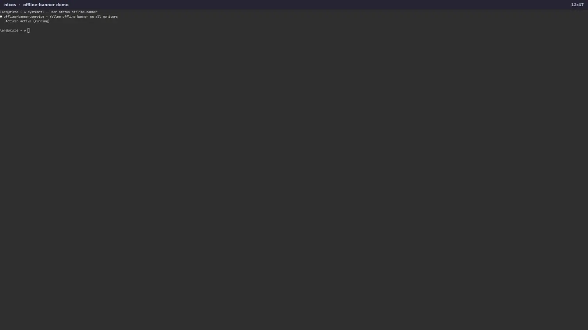

<h1 align="center">offline-banner</h1>

<p align="center"><strong>The moment your network dies, a yellow strip slides in on every monitor — and slides away the moment it's back.</strong></p>

<p align="center">
<a href="https://github.com/LarsArtmann/offline-banner/actions/workflows/checks.yml"></a>
<a href="https://github.com/LarsArtmann/offline-banner/releases/latest"></a>
<a href="LICENSE"></a>
</p>

<p align="center">
<a href="https://offline-banner.lars.software">Documentation</a> · <a href="https://offline-banner.lars.software/#demo">Watch the 24s demo</a>
</p>

A yellow top-strip banner for NixOS desktops that appears on **every monitor** while your network is offline — and slides away the moment it's back.

Connectivity loss is a **warning, not a page**: the banner is a static, non-flashing yellow strip (no blinking, no urgency colors) that shows up ~10 seconds after the network is actually gone, tells you *why* ("Network link is down" vs "No internet connection") and *when* you were last online, and dismisses on click if you've seen it.



## Why?

Because the worst moment to discover your network is down is the moment you needed it — a dead call, a stalled build, a spinner that never ends — with nothing on screen telling you it's not your fault.

And the obvious fix lies. `nmcli networking connectivity` reads NetworkManager, and NetworkManager lies on servers and hybrid hosts: a static-IP ethernet uplink is NM-unmanaged, so NM's connectivity state reads `none` while the internet is perfectly reachable (live-verified on the origin host). offline-banner doesn't ask NetworkManager. It probes:

1. **Link leg** — any real interface (lo/veth/tailscale/wireguard/docker/... excluded) with `carrier 1`, read straight from `/sys/class/net`. No carrier → *"Network link is down"*.
2. **Internet leg** — one ICMP echo to `probeHost` (default `9.9.9.9`, an **IP, not a name**: DNS is often half-broken exactly when the banner matters, and the banner must never depend on the resolver). No echo → *"No internet connection"*.

A probe that cannot even run counts as a failure — fail visible, never fail silent.

## Who is this for?

- **NixOS flake users on Wayland compositors** who want one line in their config, not a network applet framework.
- **Multi-monitor desktops** where a single widget in one bar leaves the other screens lying to you.
- **Static-IP / hybrid hosts** (servers-turned-workstations, bridges, VMs) where NetworkManager-unmanaged uplinks make NM-based indicators read the wrong answer.
- **Journal people** who trust `journalctl` and a state file more than a tray icon that silently died last Tuesday.

## What you get

|                                            | offline-banner | NM-based applet | Nothing |
| ------------------------------------------ | :------------: | :-------------: | :-----: |
| Honest on NM-unmanaged uplinks             |       ✓        |        ✗        |    —    |
| Visible on **every** monitor               |       ✓        |     one bar     |    —    |
| Pushes content down, never covers it       |       ✓        |       ✗         |    —    |
| Says *why* (link down vs no internet)      |       ✓        |        ✗        |    —    |
| Says *how long* ("last online 4m 12s ago") |       ✓        |        ✗        |    —    |
| Plays a cue on offline & recovery           |       ✓        |   varies        |    —    |
| Keeps a persistent outage log (from–to)     |       ✓        |        ✗        |    —    |
| Won't flash on one lost ping (debounced)    |       ✓        |      varies     |    —    |
| Dead probe can't fake "online" (fail-visible) |    ✓        |      varies     |    —    |
| Journal + JSON state file                  |       ✓        |        ✗        |    —    |
| Declarative: one NixOS module option       |       ✓        |        ✗        |    —    |

## How it works

1. A hardened `systemd --user` unit starts with your graphical session and probes every 5 s (two legs: kernel carrier + one ICMP echo to an IP literal).
2. `failuresToShow` consecutive failures (default 2 ≈ 10 s) open one layer-shell surface per connected monitor — a `WlrLayer.Top` strip with an **animated height** (InOutCubic, 450 ms) that pushes your bar down instead of covering it.
3. The caption re-evaluates "last online Nm Ns ago" every second while visible; click dismisses for the rest of *this* outage.
4. The first clean probe slides everything back up and re-arms the banner for the next outage — a short synthesized cue marks the show, the recovery, and the dismiss (see **Sounds** below).
5. Every transition is journaled, and a JSON state file in `XDG_RUNTIME_DIR` is rewritten every probe — a stale file means the unit is dead.
6. Every completed outage is appended to a persistent JSONL ledger — `from`/`to`/duration/reasons — so "how long were we offline?" is one `jq` away.

## When NOT to use this

- **X11 sessions** — the banner is a layer-shell (Wayland) surface, full stop.
- **GNOME / KDE** — they ship their own network indicators, and this module is proven on niri; other layer-shell compositors (sway, Hyprland) are expected but untested here.
- **You want a network monitor** — graphs, history, per-app stats are non-goals; this is one boolean, honestly derived and honestly displayed.
- **You can't accept a second Quickshell instance** — the banner deliberately runs its own [Quickshell](https://quickshell.outfoxxed.me/) process so it never depends on your bar's plugin API.

## Quickstart

```nix
# flake.nix
inputs.offline-banner.url = "github:LarsArtmann/offline-banner";
inputs.offline-banner.inputs.nixpkgs.follows = "nixpkgs"; # one nixpkgs in your lock, not two
```

```nix
# your NixOS configuration
{
  imports = [ inputs.offline-banner.nixosModules.default ];
  services.offline-banner.enable = true;
}
```

Channel policy: this flake tracks `nixos-unstable` (the NixOS-test-gated channel); consumers should keep the `follows` line above so only one nixpkgs lands in their lock — the module only needs `quickshell` from it, no channel-specific behavior.

The unit is a `systemd.user` service bound to `graphical-session.target` — it starts with the graphical session, one banner surface per connected monitor.

Startup race, by design: if the session starts with **no active monitor** (lid closed, headless boot), quickshell runs against Qt's placeholder screen — no banner surfaces exist, but the probe keeps running, so the journal and state file stay truthful (live-observed 2026-10-17 with zero outputs). Surfaces are created per monitor as outputs connect (Quickshell screen tracking).

## Behavior

- **Debounced**: `failuresToShow` consecutive failed probes (default 2 × 5 s ≈ 10 s) before appearing; hides on the *first* clean probe. No flash on a single lost ping.
- **Push-down, not cover**: the strip is a `WlrLayer.Top` layer-shell surface with `ExclusionMode.Auto` and an **animated height** (InOutCubic, 450 ms) — a top-anchored bar gets pushed down beneath it frame by frame and slides back up on recovery. Nothing is covered; nothing underneath is unreachable.
- **Last-online caption**: "last online 4m 12s ago" (or `unknown` early in the session), re-evaluated every second while visible.
- **Sounds**: short synthesized cues — the audible twin of the non-flashing yellow, warning-not-page. **One cue per outage, never per probe**: a soft two-note droop when the banner appears (a *lower* droop for link loss — the heavier failure), an ascending sparkle on recovery, a near-inaudible tick on dismiss. Three build-time-synthesized themes — `chime` (soft sine), `droplet` (pitch-bent water plips), `retro` (8-bit square) — plus `soundTheme = "none"` for silence; `soundVolume` (0–100, default 60) tunes loudness. Playback runs `pw-play` against your session PipeWire (no assets, no network — the WAVs are synthesized in the Nix build).
- **Outage history**: every completed outage appends one JSON line to `~/.local/state/offline-banner/history.jsonl` — `{"from":…,"to":…,"durationSec":…,"reasons":[…],"probeFailures":N}` — persistent across reboots, so `jq '[.durationSec] | add' history.jsonl` answers "how long was I down in total?". Sub-debounce blips never become entries; an outage still open when the unit stops is not written (the journal still has it); demo mode never writes. That directory is the unit's only writable path under your home — everything else stays read-only.
- **Click to dismiss**: hides for the rest of *this* outage; the next clean probe re-arms it so a fresh outage shows again.
- **Observable**: every probe failure, banner show/hide, and dismissal is logged to the journal, and the current state is mirrored to `offline-banner.state` in `XDG_RUNTIME_DIR` (rewritten every probe — a stale file means the unit is dead). See [Observability](#observability).
- **Demo mode**: `OFFLINE_BANNER_DEMO=1` forces the banner visible with no probes at all — safe demos and post-deploy checks, no unroutable-IP drop-in hack.
- **Own Quickshell instance**: renders as a second Quickshell process — no plugin into your existing shell/bar required (zero dependence on any shell plugin API); targets any layer-shell compositor (proven on niri; others expected but untested here).
- **Hardened unit**: the service runs under a strict systemd sandbox (`ProtectSystem=strict`, restricted address families, kernel/clock/hostname protections) — it reads `/sys`, pings, and talks Wayland; nothing else. Its only writable paths are the two runtime dirs (`RuntimeDirectory`), including the Qt/fontconfig cache via `XDG_CACHE_HOME`.

## Options

| Option                 | Type    | Default            | Description                                                                                                                    |
| ---------------------- | ------- | ------------------ | ------------------------------------------------------------------------------------------------------------------------------ |
| `enable`               | bool    | `false`            | Enable the banner                                                                                                              |
| `package`              | package | `pkgs.quickshell`  | Quickshell package to run                                                                                                      |
| `checkIntervalSeconds` | int > 0 | `5`                | Seconds between connectivity probes (env-override values ≤ 500 fall back to the 5000 ms default — sub-half-second probing is refused) |
| `probeHost`            | string  | `"9.9.9.9"`        | IP pinged for the internet leg (keep it an IP, not a name; IPv4 literal by default — see the v6 note below)                     |
| `probeTimeoutSeconds`  | int > 0 | `3`                | ping timeout (asserted `< checkIntervalSeconds` — probes must never overlap)                                                    |
| `failuresToShow`       | int > 0 | `2`                | Consecutive failed probes before the banner appears (debounce; bounded ≤ 10 so a fat-fingered value can't make the banner unreachable) |
| `layerNamespace`       | string  | `"offline-banner"` | WlrLayershell namespace (find the surface via e.g. `niri msg layers`)                                                           |
| `soundTheme`           | enum    | `"chime"`          | Synthesized cue set: `chime`, `droplet`, `retro`, or `"none"` for silence (see [Behavior](#behavior))                          |
| `soundVolume`          | 0–100   | `60`               | Cue volume percent (linear factor to `pw-play`; PipeWire stream volume still applies on top)                                  |
| `enableHistory`        | bool    | `true`             | Append one JSON line per completed outage to `historyPath`                                                                     |
| `historyPath`          | string  | `"%h/.local/state/offline-banner/history.jsonl"` | Persistent outage ledger (JSONL); `%h`/`%t` systemd specifiers expand, must be absolute |

## Runtime tuning & demos

The unit's `OFFLINE_BANNER_{INTERVAL,PROBE_HOST,PROBE_TIMEOUT,FAILURES}` environment variables mirror the options — a drop-in override (`systemctl --user edit offline-banner`, then restart the unit: env is read at start) retunes a live system without a rebuild, and `OFFLINE_BANNER_DEMO=1` forces the banner visible without touching the probe at all. The env contract is asserted by the `module-contract` flake check, so it cannot silently drift from the options.

Sounds and history ride the same contract: `OFFLINE_BANNER_SOUND_THEME`/`SOUND_VOLUME`/`SOUNDS` (the synthesized wav dir) and `OFFLINE_BANNER_HISTORY` are set from the options and gated by the same check. Unset — for a bare `quickshell -p` run, a test harness, or a demo — both features are inert: no sound is attempted and nothing is written to your home.

The README demo above is the real store QML captured in headless sway (`scripts/capture-demo.sh`) — only the carrier bit is scripted, nothing about the banner is mocked.

## Observability

A dead banner must never be silent:

- **Journal**: every transition logs a structured, grep-able line — `probe failed reason=net failures=1/2`, `probe ok recovered_after=2`, `banner state=shown|hidden|dismissed reason=… failures=N/M`, `outage ended from=… to=… duration=…s reasons=net,link` — e.g. `journalctl --user -u offline-banner -f | grep "banner state="`.
- **State file**: `$XDG_RUNTIME_DIR/offline-banner/state` holds a JSON snapshot (`active`, `reason`, `failures`, `failuresToShow`, `since`, `updatedAt`) rewritten on **every probe**. Fail-closed semantics: if `updatedAt` is older than ~2 probe intervals, the unit is effectively dead — treat the banner as absent and check `systemctl --user is-active offline-banner`. `since` carries the current outage's start (epoch seconds, `null` while fine) for "offline for N" widgets. A reference waybar consumer ships in `contrib/offline-banner-waybar`: it shows an offline widget while active, stays empty while fine, and flips to a `stale` marker once the heartbeat exceeds `OFFLINE_BANNER_MAX_AGE` (default 15 s).
- **Outage ledger**: `$XDG_STATE_HOME`-style `~/.local/state/offline-banner/history.jsonl` (see [Behavior](#behavior)) — one JSON line per completed outage, persisted across reboots: `jq -s 'sort_by(-.durationSec) | .[0:5]' ~/.local/state/offline-banner/history.jsonl` lists your five worst outages.
- **v6 note**: `probeHost` defaults to an IPv4 literal. On a v6-primary uplink with a broken v4 route the banner shows offline while v6 browsing works — an accepted tradeoff; point `probeHost` at a v6 literal on v6-primary hosts (`ping` dials it directly).

## Provenance

Extracted from [SystemNix](https://github.com/LarsArtmann/SystemNix) (`modules/nixos/desktop/offline-banner.nix`, deployed as gen 904) on 2026-10-16, at v3 behavior: bar push-down animation, last-online caption, click-dismiss.

## License

[MIT](LICENSE)
