# Pareto Execution Plan — offline-banner

**Generated:** 2026-10-17 00:01 CEST · **Source backlog:** `TODO_LIST.md` @ HEAD (rebuilt + verified 2026-10-16 docs-health audit) + new items surfaced by `docs/status/2026-10-16_23-58_docs-health-audit.md` §f · **Scope:** ALL open TODOs, ranked and split.

**Format note:** the pareto-planning skill defaults to an HTML report; you explicitly demanded `.md` with a mermaid.js graph — honored, flagged, not propagated.

## Errata / Step-0 corrections (skill: verify before ranking)

- All 21 TODO_LIST rows re-verified open tonight by the docs-health audit — none were already done; no re-dispatch.
- Daemon-commit review (audit report §d3) executed: `f9308d6` = only `.config/metadata.yaml`; `0788657` = FEATURES+ROADMAP; `fff0b61` = the four doc edits. Nothing unexpected was swept.
- **New tasks surfaced → added to TODO_LIST.md (per skill canon):** `.config/metadata.yaml` fate (§f5), docs drift gate (§f28), AGENTS pointers line (§f10).
- **Folded:** gen-904 verification (§f7) into the existing claim-cleanup row.
- **Executed in-plan:** §f30 (this pareto pass). **Declined:** §f29 (severity-rule formalization — not repo work; belongs to the docs-health skill's home repo).

## Pareto breakdown

Customer = (a) the live evo-x2 desktop via the SystemNix cutover, (b) public flake consumers, (c) future agent sessions. Value = verified-correctness on the live host, public trust, and single-source-of-truth.

### The 1% that delivers 51%

**T01 — re-pin the CI installer action (one line) + watch the first green run.**
Nothing else compounds without it: today every "verified" claim is local-only, the release/badge/trust story is dead, and every future change lands on a red pipeline. 10 minutes of work, majority of the signal.

### The 4% that delivers 64%

T01 + **T02 live smoke test** + **T03 aarch64 decision** — the verification tripod:
- T02 converts the sandbox from "reasoned" to "live-proven" and unblocks the cutover (the project's worst failure mode is a silently absent banner).
- T03 makes `nix flake check --all-systems` honest instead of aspirational.

### The 20% that delivers 80%

The trust-and-consolidation block: **T04 SystemNix cutover** (kills the two-repo split brain), **T05 LICENSE** (public users currently have no legal right to use this), **T06 tag v0.1.0 + release + topics + badge**, **T07 full-line sandbox contract**, **T08 systemd-analyze gate**, **T09 formatter/BuildFlow decision**, **T10 nixpkgs channel policy**, **T11 metadata.yaml fate**.

### The other 80% of effort → last 20% of result

Product depth and tail-hardening: T12 observability, T13 VM/negative test, T14 IPv6, T15 demo mode, T16 claim cleanup, T17 CI hardening, T18 live-verification debts, T19 docs drift gate, T20 small guards, T21 optionDoc decision, T22 demo GIF. Valuable, none of it blocks trust or the live host.

## Level 1 — comprehensive plan (30–100 min tasks, sorted by importance/impact/effort/customer-value)

| ID | Task | Tier | Impact | Effort | Customer value | Depends on |
|----|------|------|--------|--------|----------------|------------|
| T01 | Fix CI installer pin + workflow hygiene (`permissions`, `persist-credentials`), push, first green run | 1% | Critical | S (30m) | Every future change CI-verified; public trust restored | — |
| T02 | Hardened-unit live smoke test on evo-x2 (`systemd-run --user` + `quickshell -p`; render, ping, click-dismiss, Qt warnings, RSS vs MemoryMax) | 4% | Critical | M (90m) | Live-host safety — the banner must never silently die | — |
| T03 | aarch64 decision (QEMU/binfmt in CI vs drop from `systems`) + implement | 4% | High | S–M (45m) | `--all-systems` green for real; honest system matrix | T01 |
| T04 | SystemNix cutover: flake input, relock, thin wrapper, `layerNamespace` parity, deploy, delete in-tree module + retire its TODO rows + AGENTS update | 20% | Critical | M–L (100m) | Kills the two-repo split brain; one source of truth | T02 |
| T05 | LICENSE: owner decision → write file + metadata | 20% | High | S (30m) | Public users legally allowed to use the module | user |
| T06 | Tag `v0.1.0` + GitHub Release (CHANGELOG body) + repo topics + CI badge | 20% | High | S (30m) | Consumers can pin versions; discoverability | T01, T05 |
| T07 | Extend `sandboxInUnit` contract to every sandbox option line | 20% | Medium | S (30m) | Hardening cannot silently rot in a refactor | — |
| T08 | `systemd-analyze verify` gate: one-off, then automate as flake check | 20% | High | S–M (60m) | Unit-typo class caught mechanically | — |
| T09 | Formatter/BuildFlow decision: dprint fate (wire/drop/reserve) + buildflow `.gitignore` block (cover or trim) + AGENTS style-rule reconciliation | 20% | Medium | S (30m) | Ends the two-arbiter split brain; markdown gets a gate or dies honestly | — |
| T10 | nixpkgs channel decision (`nixpkgs-unstable` vs `nixos-unstable`) + consumer-follows policy doc | 20% | Medium | S (30m) | Consumer lock hygiene; convention alignment | — |
| T11 | `.config/metadata.yaml` fate: identify creator, trash-or-keep, gitignore if transient | 20% | Medium | S (15–30m) | Repo cleanliness; daemon-proof against future sweeps | — |
| T12 | State-transition observability: journal lines on show/hide + `offline_banner_active` fail-closed gauge | rest | High | M (90m) | A dead banner becomes visible instead of silent | — |
| T13 | VM/negative test: `OFFLINE_BANNER_SYSROOT` + probe injection + link/net/ok/debounce assertions | rest | High | L (100m+) | Transition logic machine-verified; regression safety net | — |
| T14 | IPv6 probe leg or documented v4-only tradeoff | rest | Medium | S–M (45m) | Correctness on v6-capable hosts | — |
| T15 | Demo mode `OFFLINE_BANNER_DEMO=1` (force-show, no probes) | rest | Medium | S (30m) | Safe demos + post-deploy checks; retires unroutable-IP hack | — |
| T16 | Claim cleanup: DMS layer-shell claim verify-or-soften; gen-904 verify-or-flag; iface-list cross-ref to wifi-failover; AGENTS pointers to FEATURES/ROADMAP | rest | Medium | S (30m) | Docs tell the whole verified truth | — |
| T17 | CI hardening: branch protection, dependabot/renovate for pins, actionlint/zizmor evaluation | rest | Medium | S (45m) | Supply-chain safety; pin drift impossible | T01 |
| T18 | Live-verification debts: reboot/re-login auto-start, multi-monitor proof, click-dismiss harness | rest | Medium | M (90m) | Claimed behaviors actually proven | T02 |
| T19 | Docs drift gate: flake check re-deriving FEATURES/TODO facts (option names, env vars) — extends the module-contract pattern | rest | Medium | M (90m) | Docs stay true mechanically, not by discipline | T07 (pattern) |
| T20 | Small guards: `failuresToShow` sanity bound + `restartTriggers` store-QML assertion | rest | Low | S (30m) | Fat-finger and rename-drift safety | — |
| T21 | optionDoc render check decision (nixos-option manual vs README-table surface) | rest | Low | S (15m) | Docs surface decided once | — |
| T22 | Demo GIF for README (capture push-down animation, size-optimize, embed) | rest | Low | M (60m) | Visual product finally shows itself | T15 (helps) |

**Out of scope by design (ROADMAP, not TODO):** DNS-leg probe, multi-host `probeHost` semantics, no-restart retuning / ExecReload story, second-compositor proof. Do not Verschlimmbesser these into bounded tasks without a demand signal.

## Level 2 — fine breakdown (all tasks ≤ 12 min, execution order within parent; parents sorted as above)

| ID | Task | ≤ min | Parent |
|----|------|-------|--------|
| T01.1 | Resolve real `nix-installer-action` commit SHA via `gh api repos/.../commits/<sha>` (validate resolvable) | 8 | T01 |
| T01.2 | Edit `.github/workflows/checks.yml:16` to the verified SHA + fix the `# vN` comment | 5 | T01 |
| T01.3 | Add `permissions: contents: read` to the workflow | 5 | T01 |
| T01.4 | Add `persist-credentials: false` to the checkout step | 5 | T01 |
| T01.5 | Commit + push; confirm the run starts | 8 | T01 |
| T01.6 | Watch the run; confirm first-ever green `nix flake check` in CI | 10 | T01 |
| T02.1 | Write the `systemd-run --user` sandbox recipe (all serviceConfig properties mirrored) into a scratch file | 10 | T02 |
| T02.2 | Run standalone `quickshell -p` demo under the sandbox properties on evo-x2 | 12 | T02 |
| T02.3 | Verify banner renders on every connected monitor | 10 | T02 |
| T02.4 | Verify probe result (`journalctl --user` or debug log): ok/net/link transitions | 10 | T02 |
| T02.5 | Click-to-dismiss check: banner hides, re-arm on simulated recovery | 8 | T02 |
| T02.6 | Confirm `ProtectSystem=strict` yields only benign Qt cache-write warnings | 10 | T02 |
| T02.7 | Measure Quickshell RSS vs `MemoryMax=256M`; record | 10 | T02 |
| T02.8 | Record verdict in a status report; flip FEATURES sandbox row if clean | 10 | T02 |
| T03.1 | Check SystemNix host inventory for any aarch64 host (or ask owner) | 5 | T03 |
| T03.2 | Decide: drop `aarch64-linux` vs QEMU/binfmt in CI | 10 | T03 |
| T03.3 | Implement the decision (flake `systems` or CI binfmt config) | 12 | T03 |
| T03.4 | Run/observe `nix flake check --all-systems` green | 8 | T03 |
| T04.1 | Add `offline-banner` flake input to SystemNix | 8 | T04 |
| T04.2 | Renlock SystemNix (`nix flake update offline-banner`) | 5 | T04 |
| T04.3 | Build the evo-x2 config with the input present | 12 | T04 |
| T04.4 | Convert SystemNix's in-tree module to a thin wrapper importing this module | 12 | T04 |
| T04.5 | Set `layerNamespace = "systemnix:offline-banner"` for live parity | 5 | T04 |
| T04.6 | Parity-diff old in-tree unit text vs new unit text | 12 | T04 |
| T04.7 | Deploy to evo-x2 + live verify (banner + probe under real conditions) | 12 | T04 |
| T04.8 | Delete in-tree module, retire SystemNix TODO rows, update AGENTS.md Consumers | 12 | T04 |
| T05.1 | Owner picks the license (question pending — GPLv3/MIT/Apache) | 0 (user) | T05 |
| T05.2 | Write LICENSE file + any module metadata | 10 | T05 |
| T05.3 | Commit + verify GitHub renders it | 5 | T05 |
| T06.1 | Tag `v0.1.0` (annotated) | 5 | T06 |
| T06.2 | `gh release create` with the CHANGELOG 0.1.0 body | 10 | T06 |
| T06.3 | Set repo topics (`nixos`, `quickshell`, `wayland`, `layer-shell`) | 5 | T06 |
| T06.4 | Add CI badge to README | 5 | T06 |
| T06.5 | Verify badge renders green; push | 5 | T06 |
| T07.1 | Extract the full sandbox directive list from `module.nix:310-346` | 8 | T07 |
| T07.2 | Extend `sandboxInUnit` in `flake.nix` to assert every line | 10 | T07 |
| T07.3 | `nix flake check` green | 5 | T07 |
| T07.4 | Negative test: locally comment out one sandbox line, confirm the check fails | 10 | T07 |
| T08.1 | Scratch derivation writing `unit.text` to `$out` | 12 | T08 |
| T08.2 | Run `systemd-analyze verify` locally on it | 10 | T08 |
| T08.3 | Triage sandbox-directive warnings (expected-benign vs real) | 12 | T08 |
| T08.4 | Wrap as a flake check (only if the spike proved feasible) | 12 | T08 |
| T08.5 | Wire into `checks` + run green | 8 | T08 |
| T08.6 | Document the gate in AGENTS.md Checks section | 5 | T08 |
| T09.1 | Evaluate dprint options: wire into treefmt / drop / document as reserved | 12 | T09 |
| T09.2 | Implement the chosen option | 12 | T09 |
| T09.3 | Resolve the buildflow `.gitignore` block: add `.buildflow.yml` or trim the block | 10 | T09 |
| T09.4 | Update the AGENTS.md style rule to match reality | 5 | T09 |
| T09.5 | `nix fmt` + `nix flake check` green | 5 | T09 |
| T10.1 | Diff `nixpkgs-unstable` vs `nixos-unstable` for this use (quickshell/iputils freshness) | 10 | T10 |
| T10.2 | Decide + flip the flake input if needed | 8 | T10 |
| T10.3 | Document the consumer-follows policy (README quickstart note) | 10 | T10 |
| T10.4 | Relock + check green | 8 | T10 |
| T11.1 | Identify what created `.config/metadata.yaml` (tool docs/source search) | 10 | T11 |
| T11.2 | Trash it (or keep) + gitignore transient paths if warranted | 5 | T11 |
| T11.3 | Commit the removal | 5 | T11 |
| T12.1 | Add journal stderr lines on banner show/hide in QML | 12 | T12 |
| T12.2 | Add probe-failure journal line (reason + failure count) | 10 | T12 |
| T12.3 | Design the fail-closed `offline_banner_active` gauge + unit-alive metric | 12 | T12 |
| T12.4 | Implement metric emission in module/QML | 12 | T12 |
| T12.5 | Document the metric (README/AGENTS one-liner) | 10 | T12 |
| T12.6 | Live-verify journal lines + gauge on evo-x2 | 10 | T12 |
| T12.7 | `nix flake check` green + commit | 8 | T12 |
| T13.1 | Add `OFFLINE_BANNER_SYSROOT` env plumbing (default `/sys`) to the probe script | 12 | T13 |
| T13.2 | Parameterize the probe command for injection | 10 | T13 |
| T13.3 | Write transition test: link/net/ok assertions | 12 | T13 |
| T13.4 | Write debounce assertion test (failuresToShow) | 12 | T13 |
| T13.5 | QEMU VM test harness skeleton (nixosTests style) | 12 | T13 |
| T13.6 | Wire the test into flake checks | 12 | T13 |
| T13.7 | Run + iterate to green | 12 | T13 |
| T13.8 | Document the test in AGENTS.md Checks | 8 | T13 |
| T14.1 | Decide: v6 probe leg vs documented tradeoff | 10 | T14 |
| T14.2 | Implement the leg or the option-description tradeoff note | 12 | T14 |
| T14.3 | `nix flake check` green | 5 | T14 |
| T14.4 | README/FEATURES note update | 5 | T14 |
| T15.1 | Add `OFFLINE_BANNER_DEMO` env handling in QML (force-show, probes skipped) | 12 | T15 |
| T15.2 | README Runtime-tuning section note | 5 | T15 |
| T15.3 | Check green + commit | 8 | T15 |
| T16.1 | Test or soften the "DMS plugins cannot render layer-shell" claim (module header + README) | 12 | T16 |
| T16.2 | Verify "gen 904" against SystemNix deploy history; fix or flag as unverified | 8 | T16 |
| T16.3 | Add iface-exclude-list cross-reference comment → SystemNix wifi-failover QML | 8 | T16 |
| T16.4 | Add AGENTS.md pointers line to FEATURES.md/ROADMAP.md | 5 | T16 |
| T17.1 | Branch protection on master requiring the Checks workflow (gh api) | 10 | T17 |
| T17.2 | Dependabot/renovate config for the two action pins | 10 | T17 |
| T17.3 | Evaluate actionlint/zizmor; add if value confirmed | 12 | T17 |
| T17.4 | Commit + verify a PR-triggered run | 8 | T17 |
| T18.1 | Reboot evo-x2; verify auto-start via graphical-session.target | 12 | T18 |
| T18.2 | Re-login path verification | 10 | T18 |
| T18.3 | Multi-monitor proof (banner on every screen) | 12 | T18 |
| T18.4 | Click-to-dismiss machine-verification (virtual-pointer harness or scripted live outage) | 12 | T18 |
| T18.5 | Record results; flip FEATURES rows where proof landed | 8 | T18 |
| T19.1 | Enumerate mechanically-checkable doc facts (7 option names, env-var names, unit markers) | 12 | T19 |
| T19.2 | Write the drift-check derivation (module-contract pattern) | 12 | T19 |
| T19.3 | Wire into flake checks | 10 | T19 |
| T19.4 | Plant a stale fact locally; verify the gate fires | 12 | T19 |
| T19.5 | Restore + gate green | 5 | T19 |
| T19.6 | Document in AGENTS.md Checks | 5 | T19 |
| T20.1 | `failuresToShow` upper-bound assertion in module.nix | 10 | T20 |
| T20.2 | `restartTriggers` store-QML assertion in checks | 10 | T20 |
| T20.3 | `nix flake check` green | 5 | T20 |
| T21.1 | Evaluate nixos-option render value vs README table | 10 | T21 |
| T21.2 | Decide + record the decision (README or AGENTS one-liner) | 5 | T21 |
| T22.1 | Capture the push-down animation (screen recorder, forced offline via demo mode) | 12 | T22 |
| T22.2 | Convert to GIF + size-optimize (<2 MB) | 12 | T22 |
| T22.3 | Embed in README + verify rendering | 8 | T22 |
| T22.4 | Commit | 5 | T22 |

**Totals:** 22 L1 tasks (30–100 min each) · 108 L2 tasks (all ≤ 12 min).

## Execution graph

```mermaid
flowchart TD
    subgraph g1["1% → 51%"]
        T01["T01 CI pin fix → first green run"]
    end
    subgraph g4["4% → 64% — verification tripod"]
        T02["T02 Live smoke test (evo-x2)"]
        T03["T03 aarch64 decision"]
    end
    subgraph g20["20% → 80% — trust & consolidation"]
        T04["T04 SystemNix cutover"]
        T05["T05 LICENSE"]
        T06["T06 v0.1.0 release"]
        T07["T07 Sandbox full-line contract"]
        T08["T08 systemd-analyze gate"]
        T09["T09 Formatter/BuildFlow decision"]
        T10["T10 nixpkgs channel policy"]
        T11["T11 metadata.yaml fate"]
    end
    subgraph gr["Other 80% of effort → last 20%"]
        T12["T12 Observability"]
        T13["T13 VM/negative test"]
        T14["T14 IPv6 leg/tradeoff"]
        T15["T15 Demo mode"]
        T16["T16 Claim cleanup + gen-904"]
        T17["T17 CI hardening"]
        T18["T18 Live-verification debts"]
        T19["T19 Docs drift gate"]
        T20["T20 Small guards"]
        T21["T21 optionDoc decision"]
        T22["T22 Demo GIF"]
    end
    T01 --> T03
    T01 --> T06
    T01 --> T17
    T02 --> T04
    T02 --> T18
    T05 --> T06
    T07 -.->|pattern reuse| T19
    T15 --> T22
```

## Sequencing rules

1. T01 first, always — it is the 1%.
2. T02 can run in parallel with T01 (live host, not CI).
3. T04 (cutover) is strictly gated on T02 — no eval-only-verified sandbox onto the live desktop (fail-visible doctrine).
4. T06 (release) after T01 + T05 — never release on a red pipeline or without a license.
5. Decision tasks (T03, T05, T09, T10, T11, T21) are cheap and unblock others — batch them in one sitting if energy is low.
6. Do not Verschlimmbesser: every change leaves the repo verifiably no worse (gate green before and after; no speculative rewrites).

---

*Point-in-time snapshot — will go stale. New tasks surfaced here are already added to TODO_LIST.md (living source). When a later session brings this plan current, use docs-health ANNOTATE — never rewrite.*
