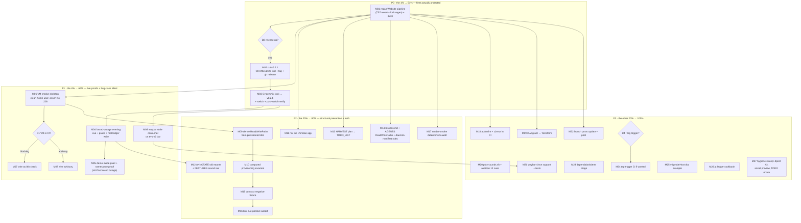

# Never Again — Post-Incident Pareto Execution Plan

**Written:** 2026-11-05 19:03 CET · **Input state:** `ad6cac3` (the 226/NAMESPACE fix, all 7 checks × 2 systems green, unpushed) + daemon commit `fedca3f` (the 18:52 status report) + in-flight website-pipeline repair.
**Inputs read:** `TODO_LIST.md` (14 open items), `ROADMAP.md`, `docs/status/2026-11-05_18-52_226-namespace-live-outage-postmortem-status.md` (§f, 40 items), `docs/planning/2026-10-17_00-01_pareto-execution-plan.md` (series), CI state via `gh run list/view`.
**Mission:** close the 2026-11-05 live-outage incident end-to-end — fleet actually protected, every "rides the switch" debt retired, the dead-unit bug class made structurally impossible, and the docs honest again.

## Errata — stale backlog entries found during planning (Step 0 verification)

1. **TODO "Squash daemon-swept auto-commits" is CLOSED** — `ad6cac3` squashed this session's sweep; `2ccdf6e` below it is already pushed (origin tip), so nothing remains squashed-able.
2. **TODO "FIREBASE_SERVICE_ACCOUNT secret + social preview" is STALE** — the secret has existed since 2026-10-29 (CI deploys on every website push); only the manual social-preview upload verify remains (→ M27).
3. **TODO "Live proof: %h hole" contained the bug as a hedge** — the row's parenthetical "systemd creates missing ReadWritePaths dirs — unverified here" was the FALSE assumption that shipped the incident. The row is re-framed by M04 (live proof) + M09 (structural prevention).
4. **`dprint.json` EXISTS AGAIN (3rd occurrence)** — the zombie the 2026-10-17 and 10-29 decisions keep killing. → M27 [decision].
5. **NEW, found this session: Website CI on master has been RED since 2026-10-29 13:21** (run 40881107334, `pnpm install` exit 1). Cause: daemon auto-commit `2ccdf6e` swept version bumps in `website/package.json` WITHOUT regenerating the lockfile — the exact codified pnpm rule — AND included the forbidden `typescript ^6.0.3 → ^7.0.2` bump (silently strips `astro check` from the gate). Second incident of a red pipeline sitting on master unnoticed; this one authored by the auto-commit heuristic, not a human. → M01 (repair, in progress this session) + M14 (rule: daemon must never own dependency manifests).
6. Dependabot updater runs green (last 2026-10-30); the 20-alert triage item is unchanged (→ M23).

## Pareto breakdown

- **The 1% that delivers 51%** — M01–M03 (~2.5 h): repair the Website pipeline, push the fix, cut v0.2.1, bump SystemNix's lock, switch. Until this lands, evo-x2 is protected only by a manual `mkdir`; every other task is decoration.
- **The 4% that delivers 64%** — M04–M08: one forced-outage evening closes ALL live-proof debts at once (sound cue from the hardened unit, real-monitor pixels, first real ledger write); the VM smoke test kills the entire dead-unit class; the waybar `stale` consumer makes a dead banner visible in the bar within 15 s.
- **The 20% that delivers 80%** — M09–M17: derive ReadWritePaths from provisioned dirs (unprovisioned holes become unwritable), computed provisioning invariant, `nix run .#smoke`, annotate/harvest the docs to truth, deepen the contract (negative fixture, link-cue, render-smoke determinism).
- **The other 20% (to 100%)** — M18–M27: CI hygiene (actionlint/zizmor, tag trigger), IAM → Terraform, sound audition, waybar `since`, launch posts, dependabot triage, v6 doc example, jq cookbook, hygiene sweep (dprint zombie #3, social preview, errata application).

## Decision gates (owner)

- **D1** — VM smoke test in CI: blocking 8th check (tcg-slow, ~minutes/run) vs advisory. Recommendation: blocking.
- **D2** — v0.2.1 release go (tagging is owner-gated by runbook). Recommendation: immediately after M01's CI green.
- **D3** — Lost ledger window (switch → fix): accept, or backfill from router/NM logs marked `backfilled:true`.
- **D4** — dprint.json zombie #3: re-drop per standing decision, or adopt a real `.buildflow.yml`.

## Execution graph

## Medium granularity — 27 tasks, 30–100 min each (sorted: importance → impact → effort → customer value)

| ID | Task | Why / context | Effort | Value | Depends | Status |
|----|------|---------------|--------|-------|---------|--------|
| M01 | Repair Website pipeline + push everything | TS ^7 bump (strips astro check) + un-locked manifest drift from daemon commit 2ccdf6e → Website CI red on master since 10-29. Revert TS to ^6.0.3, `pnpm install` regen lock (24 h age gate), astro check + build + html-validate, squash `fedca3f` into a real docs commit, push fix + docs + plan. Un-reds master; release runbook requires both workflows green on HEAD. | 45 m | ★★★★★ | — | **in progress** (TS reverted, lock regen running) |
| M02 | Cut v0.2.1 | The fix must exist as a tag for SystemNix to lock. Fold CHANGELOG [Unreleased]→0.2.1 + compare link; website changelog.mdx 0.2.1 section (docs must describe the tagged tree); re-run gates; tag + `gh release create` (curated: unblock command for affected hosts). Owner-gated (D2). | 45 m | ★★★★★ | M01 CI green | ready |
| M03 | SystemNix lock → v0.2.1 + switch + verify | evo-x2 currently protected by manual mkdir + old gen. Bump input, eval, switch (owner-run), then verify: unit active, rendered unit carries StateDirectory, state-file heartbeat, `probe ok` on the real NIC. Update AGENTS Consumers lock rev. | 60 m | ★★★★★ | M02 | ready [owner switch] |
| M04 | Forced-outage live-proof evening | One drop-in run closes three "rides the switch" debts at once: `OFFLINE_BANNER_PROBE_HOST=192.0.2.123` + restart → banner state=shown, cue audible from the hardened unit, grim capture on the real monitor; restore → recover cue + first real `history.jsonl` entry via jq; annotate FEATURES sound+ledger rows + AGENTS live-proof notes. | 60 m | ★★★★★ | M03 (or M01 if eager) | ready |
| M05 | Demo-mode pixel + namespace proof | If a forced outage is undesired: `OFFLINE_BANNER_DEMO=1` transient + grim capture + layer-namespace check via the compositor's layer tool. Closes the real-monitor render claim without an outage. | 30 m | ★★★★ | M01 | ready (alt to M04 pixels) |
| M06 | VM smoke test — skeleton | The check class that would have caught 226/NAMESPACE: nixpkgs `runTest` node importing the module, normal user with a CLEAN home (the incident condition), autologin → user manager → unit start; assert quickshell reached exec (journal INFO) and NO `Failed at step NAMESPACE`. No compositor needed for the class-kill assert. | 90 m | ★★★★★ | — | not started |
| M07 | VM smoke — CI wiring + policy | Wire into `checks.x86_64-linux` (tcg on GitHub runners, no KVM); decide blocking vs advisory per D1; local green run first. | 45 m | ★★★★ | M06, D1 | not started |
| M08 | Waybar `stale` consumer on evo-x2 | The designed dead-banner tell, deployed nowhere — the exact reason the incident sat invisible for days. Wire contrib consumer into the bar (SystemNix side); a dead unit is then visible within one heartbeat (15 s). | 30 m | ★★★★★ | — | not started |
| M09 | Derive ReadWritePaths from provisioned dirs | Writable set = `%t/` RuntimeDirectory ∪ `%h/.local/state/` StateDirectory, computed — a hand-written unprovisioned hole becomes unwritable, not merely forbidden. module-contract line-pins must keep passing (rendering identical). | 60 m | ★★★★ | — | not started |
| M10 | Computed provisioning invariant | Replace/augment per-line grep pins: eval computes "every ReadWritePaths entry maps to a provisioned dir" (specifier-aware) and fails otherwise. Generalizes yesterday's one-off pin to the rule. | 45 m | ★★★★ | M09 | not started |
| M11 | `nix run .#smoke` flake app | The runbook's hardened transient as versioned code, substituting `%h`→`$HOME`, `%t`→`$XDG_RUNTIME_DIR` so it CAN exercise the ledger hole (today's runbook structurally cannot — the blind spot that shipped the incident). Document as the mandatory pre-switch gate. | 60 m | ★★★★ | — | not started |
| M12 | ANNOTATE stale claims | 2026-10-29 sounds/ledger report + v0.2.0 postmortem + FEATURES sound row carry "rides the SystemNix switch" claims invalidated by the incident; annotate in place (docs-health ANNOTATE, never rewrite) with the incident outcome. | 30 m | ★★★ | M04 evidence | not started |
| M13 | HARVEST plan → TODO_LIST/ROADMAP | This plan + the 18:52 report §f are snapshots; the living queue must absorb the open items (and apply the six errata above). | 30 m | ★★★ | M01 | not started |
| M14 | Lessons + AGENTS rules | Cross-project lesson into crush-config `references/lessons.md` (commit, not in-session write): "ReadWritePaths binds but never creates; RuntimeDirectory/StateDirectory provision; systemd-analyze verify cannot see namespace failures; tmpfiles %h invalid on systemd 261". AGENTS: the auto-commit daemon must never sweep dependency manifests (2ccdf6e = the proof). | 20 m | ★★★ | — | not started |
| M15 | module-contract negative fixture | Opt-out config (soundTheme none + enableHistory false) and the bad-historyPath assertion are eval-verified once, not gated; add a disabled-config eval + badAsserts case so the assertion's teeth are permanent. | 30 m | ★★★ | — | not started |
| M16 | Link-cue positive assert | probe-transitions asserts the link cue only negatively; trip one clean-start outage on reason=link and assert the cue fires positively. | 30 m | ★★ | — | not started |
| M17 | render-smoke determinism audit | Apply the codified flake doctrine (anchor ⇒ exact; post-switch ⇒ regex; cross-write ⇒ mtime) to the pixel gate BEFORE it flakes on a slow runner, as probe-transitions did three times. | 45 m | ★★★ | — | not started |
| M18 | Wire actionlint + zizmor into CI | Both clean but run on demand only; wire into the Checks workflow so the 3-step workflow stays honest. | 45 m | ★★ | M01 | not started |
| M19 | IAM grant → Terraform | `serviceusage.serviceUsageViewer` for the deploy SA applied via gcloud 2026-10-29, still outside IaC — a fresh apply would break deploys. Encode in the lars-software TF; apply is owner-side (GCS quota). | 30 m | ★★ | — | not started [owner apply] |
| M20 | play-sounds.sh + audition + tune | Only 2 of 12 cues ever heard by a human; add the loop script, audition all themes/events, tune frequencies/envelopes on owner feedback (re-synthesis is one rebuild). | 30 m | ★★ | — | not started [owner ears] |
| M21 | Waybar consumer `since` support | State file already carries `since`; consumer could show "offline for 4m". Plus shellcheck gate for contrib (currently contract-checked nowhere). | 20 m | ★★ | M08 | not started |
| M22 | Launch posts: sounds + ledger + ship | Drafts predate both features; one sentence each keeps the one-narrative rule; posting is owner-gated. | 30 m | ★★ | M02 | not started [owner post] |
| M23 | Dependabot / website alerts triage | 20 alerts on master (re-checked 10-17); run a `pnpm update` round UNDER the 24 h age gate with lock regen + full local verify (same procedure as M01, this time intentional). | 30 m | ★★ | M01 | not started |
| M24 | Tag-trigger CI (decision + maybe wire) | Releases tag a green commit but nothing builds the tag; add a tag trigger if a tag-only smoke ever matters. | 15 m | ★ | — | not started [decision] |
| M25 | v6 probeHost worked example | The IPv4-default tradeoff is documented; add the v6-literal config snippet for v6-primary hosts. | 20 m | ★ | — | not started |
| M26 | jq ledger cookbook | Observability page gains per-month totals, longest outages, reason histograms over history.jsonl. | 20 m | ★ | M04 (real entries) | not started |
| M27 | Hygiene sweep | dprint.json zombie #3 decision (D4) + drop-or-adopt; verify social-preview upload still set; apply the six errata to TODO_LIST; re-check repo Settings homepage/topics. | 30 m | ★★ | D4 | not started |

**Effort total:** ~13.5 h medium-granularity (P0 ≈ 2.5 h, P1 ≈ 4.2 h, P2 ≈ 4.4 h, P3 ≈ 2.6 h).

## Fine granularity — ≤ 12 min each (execute top-down inside each phase)

### P0 — the 1% → 51%

| ID | Subtask (≤12 m) | Parent |
|----|-----------------|--------|
| F01 | Revert `typescript ^7.0.2 → ^6.0.3` in website/package.json (astro check gate survives) — DONE in-session | M01 |
| F02 | `pnpm install` lock regen under `minimumReleaseAge: 1440` — in flight | M01 |
| F03 | Eyeball lock diff: typescript 6.x resolved, no `minimumReleaseAgeExclude` smuggling | M01 |
| F04 | `pnpm exec astro check` → 0 errors | M01 |
| F05 | `pnpm run build` (10 pages + CSP patch) | M01 |
| F06 | `pnpm exec html-validate "dist/**/*.html"` → exit 0 | M01 |
| F07 | Verify `fedca3f` carries only the 2 status files → `git reset --soft HEAD~1` | M01 |
| F08 | Commit website fix (manifest + lock) with the pnpm-rule why | M01 |
| F09 | Commit docs (status report + index + this plan) with detailed message | M01 |
| F10 | `git push origin master` (fix + docs + `ad6cac3`) | M01 |
| F11 | Watch Checks workflow green on pushed HEAD (incl. emulated aarch64) | M01 |
| F12 | Watch Website workflow green + first deploy of the new docs | M01 |
| F13 | Fold CHANGELOG [Unreleased] → [0.2.0.1… no: 0.2.1] + compare-link footer | M02 |
| F14 | Add 0.2.1 section to website changelog.mdx (docs describe the tagged tree) | M02 |
| F15 | Re-run `nix fmt && nix flake check --all-systems` + both workflows green → release commit | M02 |
| F16 | Owner go (D2) → `git tag -a v0.2.1` + push tag | M02 |
| F17 | `gh release create v0.2.1 --verify-tag` with curated body (unblock command first) | M02 |
| F18 | Verify: `nix flake check github:…/v0.2.1 --all-systems` + metadata resolves to the tag | M02 |
| F19 | SystemNix: bump `offline-banner` input to `v0.2.1` (lock) | M03 |
| F20 | SystemNix: evo-x2 eval green | M03 |
| F21 | Switch (owner-run) — the true StateDirectory proof on a live gen | M03 |
| F22 | Verify: unit active, rendered unit has StateDirectory, heartbeat fresh, `probe ok` | M03 |
| F23 | Update AGENTS Consumers bullet with the new lock rev + switch date | M03 |

### P1 — the 4% → 64%

| ID | Subtask (≤12 m) | Parent |
|----|-----------------|--------|
| F24 | Drop-in `OFFLINE_BANNER_PROBE_HOST=192.0.2.123` + unit restart | M04 |
| F25 | Observe `banner state=shown reason=net` in journal + banner on screen | M04 |
| F26 | Confirm the offline cue is audible from the hardened unit (pw-play under sandbox) | M04 |
| F27 | `grim` capture of the strip on the real monitor during shown | M04 |
| F28 | Restore probe host → recover cue audible + banner slides up | M04 |
| F29 | `jq` the first real history.jsonl entry; screenshot for FEATURES evidence | M04 |
| F30 | Annotate FEATURES sound + ledger rows and AGENTS live-proof notes with the evidence | M04 |
| F31 | `OFFLINE_BANNER_DEMO=1` transient + grim capture (alt pixel proof) | M05 |
| F32 | Layer-namespace check via compositor layer tool (`systemnix:offline-banner`) | M05 |
| F33 | Research `runTest` API shape on this nixpkgs; pin the pattern | M06 |
| F34 | Write vm-smoke node: module enabled, clean-home user, probeHost TEST-NET | M06 |
| F35 | Write testScript: autologin → user manager → unit start | M06 |
| F36 | Assert: no `Failed at step NAMESPACE` + quickshell exec reached | M06 |
| F37 | Local `nix flake check` run of the VM check; fix flakes (boot timing) | M06 |
| F38 | Negative-proof the VM check: revert StateDirectory in a scratch eval → test MUST fail | M06 |
| F39 | D1 decision → wire as blocking 8th check or advisory job | M07 |
| F40 | CI run green on push; measure runtime; record in AGENTS Checks | M07 |
| F41 | Wire contrib waybar consumer into evo-x2 bar config (SystemNix side) | M08 |
| F42 | Kill the unit manually → `stale` marker appears ≤ 2 heartbeats | M08 |
| F43 | Restore; note evidence in FEATURES waybar row | M08 |

### P2 — the 20% → 80%

| ID | Subtask (≤12 m) | Parent |
|----|-----------------|--------|
| F44 | module.nix: compute ReadWritePaths from RuntimeDirectory ∪ StateDirectory | M09 |
| F45 | Render check: unit text byte-identical on defaults (contract pins hold) | M09 |
| F46 | Add a scratch unprovisioned path → eval must now fail structurally | M09 |
| F47 | Full `nix flake check --all-systems` green | M09 |
| F48 | flake.nix: computed coverage check (every RW entry ↔ provisioned dir) | M10 |
| F49 | Negative-test the invariant with a synthetic hole | M10 |
| F50 | Flake app `.#smoke`: transient with literal-path substitution (%h→$HOME) | M11 |
| F51 | App runs the full sandbox recipe incl. the ledger hole; document in AGENTS runbook | M11 |
| F52 | ANNOTATE 2026-10-29 sounds/ledger report (rides-the-switch claims) | M12 |
| F53 | ANNOTATE v0.2.0 postmortem + FEATURES sound row | M12 |
| F54 | docs-health HARVEST: plan + report §f → TODO_LIST.md; apply 6 errata | M13 |
| F55 | ROADMAP: move P3 ideas (retention, live-retune, multi-host probe) if not already there | M13 |
| F56 | Write cross-project lesson (ReadWritePaths/StateDirectory/verify-blind-spot/tmpfiles-%h) in crush-config repo + commit | M14 |
| F57 | AGENTS: daemon-must-never-sweep-manifests rule + CI blind-spot note | M14 |
| F58 | flake.nix: disabled-config eval fixture (soundTheme none + history off) | M15 |
| F59 | flake.nix: badAsserts case for the new historyPath assertion | M15 |
| F60 | probe-transitions: clean-start link-trip scenario asserting the link cue positively | M16 |
| F61 | render-smoke: inventory every sleep/poll; classify anchor/transition/mtime | M17 |
| F62 | Apply the doctrine rewrites; one deliberately-slow local run to validate | M17 |

### P3 — the other 20% → 100%

| ID | Subtask (≤12 m) | Parent |
|----|-----------------|--------|
| F63 | Add actionlint step to Checks workflow | M18 |
| F64 | Add zizmor step; both green on push | M18 |
| F65 | Encode `serviceusage.serviceUsageViewer` grant in lars-software Terraform | M19 |
| F66 | Hand to owner for apply (GCS-backend quota blocks this host) | M19 |
| F67 | Write scripts/play-sounds.sh (loop pw-play over the store dir) | M20 |
| F68 | Owner audition of all 12 cues; collect frequency/envelope feedback | M20 |
| F69 | Tune genSoundsScript + rebuild + re-audition | M20 |
| F70 | Waybar consumer: render `since` as "offline for Nm" while active + tests | M21 |
| F71 | shellcheck gate for contrib/ in a check | M21 |
| F72 | Launch-post drafts: one sentence each for sounds + ledger (+ incident honesty?) | M22 |
| F73 | Owner posts Discourse + r/NixOS | M22 |
| F74 | Triage the 20 dependabot alerts; classify fixable-now vs wait | M23 |
| F75 | Intentional `pnpm update` round under the age gate + lock regen + full verify | M23 |
| F76 | D4: decide dprint.json #3 — re-drop per standing decision or adopt .buildflow.yml | M27 |
| F77 | Verify social-preview upload still set (repo Settings, manual) | M27 |
| F78 | Apply TODO errata 1–3 (closed/stale/re-framed rows) | M27 |
| F79 | Tag-trigger CI: decide + wire or record the no | M24 |
| F80 | v6 probeHost snippet in README + configuration.mdx | M25 |
| F81 | jq cookbook section in observability.mdx (month totals, longest, reasons) | M26 |

**Fine total:** 81 subtasks (≤12 min each) across 27 medium tasks; everything open from TODO_LIST, the 18:52 report §f, and this session's discoveries is included.

## Standing rules for execution

1. Never push a red pipeline again: check `gh run list` for BOTH workflows on the HEAD commit before any tag (twice burned now — v0.2.0 era and 2ccdf6e).
2. The daemon does not own dependency manifests: any `package.json`/lockfile change must be deliberate, locked, and locally verified in the same session (M01 is the incident, M23 the disciplined counter-example).
3. Do not verschlimmbessern: every step leaves the repo verifiably no worse (gates green) than before; if a task risks regression without its decision gate (D1–D4), it waits.
4. Verify-before-implement for any systemd/Nix mechanism not used before in this repo (tmpfiles-%h was caught this way; keep the discipline).
