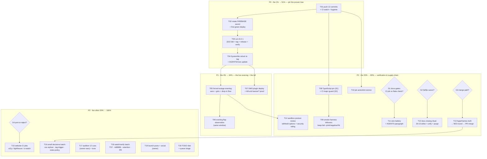

# Release, Live-Proof & Hardening — Pareto Execution Plan

**Written:** 2026-11-17 22:00 CET · **Input state:** master `e141756` (12 unpushed real commits on top of the CI-green `320be2a`), docs-gates battery PASS (freshness / audit-all / annotate / routing / cadence), `nix flake check --all-systems` green, Checks green in CI (`42903380953`), Website build green / deploy red on the stale `FIREBASE_SERVICE_ACCOUNT` (run `42902844872`).
**Inputs read:** `TODO_LIST.md` (18 open rows, re-verified fresh from disk this pass), `ROADMAP.md` (5 themes), `docs/status/2026-11-17_21-46_docs-health-corpus-sweep-status.md` (this session's a–g), `docs/planning/archived/2026-11-05_19-03_never-again-pareto-execution-plan.md` (all 27 M-tasks verdicted — nothing re-dispatched), CI state via `gh run list`, SystemNix lock via `../SystemNix/flake.lock` (320be2a).
**Mission:** pin the proven tree as v0.2.1 for public consumers, close the last two unproven product claims (cue audibility, real-monitor pixels) with one live evening, deploy the dead-banner tell, and finish the verification/supply-chain hardening — without Verschlimmbessern anything.

**Customer =** (a) the live evo-x2 desktop (the only host running the unit), (b) public flake consumers (currently pinning an untagged tree is fine for SystemNix but wrong as a long-term story), (c) future agent sessions (gates + docs truth).

## Errata / Step-0 corrections (skill: verify before ranking)

1. **All 18 open TODO rows re-verified open** during today's corpus sweep (2026-11-17) — each carries evidence and a source; no stale dispatch. The sweep itself closed rows 17/19/72 and refreshed 14/71/73, so this plan ranks only live work.
2. **NEW (found this pass): D3 had no TODO row.** The corpus sweep routed it in prose, but the freshness gate caught that "D3: lost-ledger-window backfill" existed in no living doc. Row added today (next to D1). Lesson: routing an item to "a TODO row" requires the row to actually exist.
3. **The hyperframes version truth is unresolved**: `website/video/package.json` manifest (per the Dependabot PR) pins 0.8.163, while AGENTS/CHANGELOG prose says 0.8.214, and the open PR wants 0.9.28. T13's first subtask settles it from the lockfile before any merge decision.
4. **`4d896fb`** (pre-session daemon commit: website/flake.lock bump, sole content) — confirm deliberate in T18; re-message on the next squash window if it was drift.
5. **Row 77 (forced-outage evening) is half-done by events**: the gen-995 genuine outage PROVED the ledger write and fired the show cue; what remains is audibility-with-ears and the real-monitor grim capture. The row already says so; T05 finishes it.
6. **The 226/NAMESPACE class is dead** (StateDirectory provisioner + invariant + vm-smoke negative + live gen 995): no task in this plan re-opens it; the release exists to PIN that proof, not to create it.

## Decision gates (owner)

- **D1** — vm-smoke in CI: blocking check (minutes of tcg per run) vs advisory. Recommendation: measure first (one timed CI run), then decide.
- **D2** — v0.2.1 release go (T03). Recommendation: immediately after T01+T02 make the runbook gate satisfiable.
- **D3** — lost-ledger-window backfill vs accept (row: D3). Recommendation: accept — the gap is documented, backfill risks polluting a machine-written ledger with forensic guesses.
- **D4** — dprint.json permanent kill: adopt `.buildflow.yml` or teach BuildFlow to skip (parked; re-drops are cosmetic today).
- **G1** — docs-gates wiring: flake check input vs CI job step (T11). Recommendation: CI job step (fast, no new flake input; the battery is stdlib-only Go).
- **G2** — §d/§e archive canon: strike-with-process-verdicts vs bare-behind-banner (T12). Owner taste; either is honest if uniform.
- **G3** — hyperframes merge path: reconcile version truth → intentional M23 update round → THEN the PR (T13). Recommendation: that order; merging the PR first would double-churn the lockfile.
- **G4** — website-CI quality jobs: port a11y-guard + lighthouse + ci-watch, or reject in AGENTS (T15). Recommendation: port ci-watch (red-master detection has burned us twice), judge a11y/lighthouse on effort.

## Pareto breakdown

- **The 1% that delivers 51%** — T01–T03 (~2 h): push the 12 proven commits, rotate the stale FIREBASE secret (the only red on master), cut v0.2.1. Until these land, the project's public story is an untagged tree and its CI story has a red deploy; everything else is decoration.
- **The 4% that delivers 64%** — T04–T07 (~3.5 h): relock SystemNix to the tag, then ONE live evening (forced outage with ears + real-monitor grim capture; flap observation rides the same window) and the DMS plugin deploy with the kill-unit proof. This closes every remaining "rides a live session" debt at once: audibility, real-monitor pixels, drop-in flow, dead-banner tell.
- **The 20% that delivers 80%** — T08–T14 (~7 h): the verification/supply-chain block — TypeScript pin + CI guard, smoke-harness leftovers, linter pins, docs-gates wired into the gate, the docs closing ritual (incl. the supervised purge), the hyperframes reconcile → M23 → merge chain, and the sandbox posture review.
- **The other 20% (to 100%)** — T15–T20 (~4 h): website-CI quality jobs decision, the small-decisions batch, sound audition (owner ears), the watch/verify batch, launch posts + social upload, and the TODO diet.

## Execution graph

## Medium granularity — 20 tasks, 30–100 min each (sorted: importance → impact → effort → customer value)

| ID  | Task | Why / context | Effort | Value | Depends | Status |
| --- | ---- | ------------- | ------ | ----- | ------- | ------ |
| T01 | Push master + watch CI + hygiene | 12 real commits (docs-health sweep + plans) sit unpushed; every green claim is local until pushed. Includes the PR/daemon-hygiene sweep (4d896fb confirm moves here if quick). Owner-adjacent: push was explicitly requested this session; future pushes stay per-instruction. | 30 m | ★★★★★ | — | ready |
| T02 | Rotate the FIREBASE secret + first green deploy | The stale `FIREBASE_SERVICE_ACCOUNT` is the only red on master (deploy auth fails, run 42902844872; build green). Owner console: new key in GitHub secrets + GCP; then `workflow_dispatch` a Website run and watch the deploy go green — this makes the release runbook's "both workflows green" satisfiable again. | 30 m | ★★★★★ | T01 | ready [owner console] |
| T03 | Cut v0.2.1 (D2) | Pins the 226-fix + legs/ladder + hardening + live-proven gen-995 tree for consumers. Fold CHANGELOG [Unreleased] → 0.2.1 (incl. the ladder bullet from ab56830), add the changelog.mdx section (docs describe the tagged tree — runbook step 2), re-run gates, annotated tag + curated release (G5: curated notes, unblock command up top), verify tag-source flake check + metadata. | 60 m | ★★★★★ | T02, D2 | ready [owner go] |
| T04 | SystemNix relock to the v0.2.1 tag | evo-x2 currently pins master rev 320be2a — fine while master == quality, but a tag pin is the point of tagging. Bump the input to the tag, eval, owner switch, verify heartbeat + `probe ok`, update AGENTS Consumers + TODO rows. | 30 m | ★★★★ | T03 | ready [owner switch] |
| T05 | Forced-outage live-proof evening | Drop-in `OFFLINE_BANNER_PROBE_HOST=192.0.2.123` + restart: confirm the show cue AUDIBLE from the hardened unit (pw-play stderr now journals since ab56830 — the journal alone can close it), grim-capture the strip on the REAL monitor, restore → recover cue. Annotate FEATURES sound/pixel rows + AGENTS live-evidence with the final evidence. Closes rows 77 + 34's live halves. | 90 m | ★★★★★ | T04 | ready |
| T06 | Evening-window flap observation | The ladder's real verdict: icmp flaps must land as silent degraded strips (blue, auto-fade, no sound, no ledger) — NEVER a yellow alarm. One journal sweep after an evening session: `banner state=shown` count must stay 0 unless tcp+dns genuinely dropped. Rides T05's session window. | 30 m | ★★★★ | T05 | ready |
| T07 | DMS plugin deploy + kill-unit proof | The dead-banner tell, deployed nowhere since the incident: enable `systemnix-banner` in DMS's plugin list (SystemNix-side eval + switch), then kill the unit → `banner?` in error-red within one heartbeat; restore. Closes rows 79 + 16's live half. | 60 m | ★★★★★ | T04 | ready [owner switch] |
| T08 | TypeScript pin + CI guard (S1+S2) | The daemon's `2ccdf6e` ^7 sweep silently stripped `astro check` for days. Add `"typescript": "~6.0.3"` to `website/package.json` overrides + a CI assert that the resolved TS major is 6. Exit strategy rides row 80. | 45 m | ★★★★ | T01 | ready |
| T09 | Smoke-harness leftovers | (1) smoke-script asserts the keep-list covers every serviceConfig key (computed, not hand-listed); (2) `.#smoke --print` dry-run mode; (3) smoke-script negative test (strip %h → gate fails); (4) probe-transitions `%t/offline-banner` historyPath scenario. One bounded pass over flake.nix. | 90 m | ★★★★ | T01 | ready |
| T10 | Pin actionlint + zizmor | The workflow-lint job floats `nixpkgs#actionlint nixpkgs#zizmor` — the same moving-pin class fixed for firebase-tools (9ace19a). Pin to the flake.lock rev; gate note. | 30 m | ★★★ | T01 | ready |
| T11 | Wire docs-gates into the quality gate | The battery passes only when someone remembers to run it. G1: CI job step (recommended — nix-shell the flake binary, run `docs-gates run .`) or a flake check input. Plus the AGENTS paragraph (battery state, PASS 2026-11-17). | 60 m | ★★★★ | T01, G1 | ready |
| T12 | Docs closing ritual | The next sweep should be trivial: strike the 20-10 §a table (cadence date ~2 days out), unify §d/§e archive canon per G2 across all 12 archived files, normalize the ROADMAP theme-1 strikethrough to plain prose, run the first SUPERVISED `docs-gates purge`, add an index-drift guard idea to the backlog. | 45 m | ★★★ | T11, G2 | ready |
| T13 | Hyperframes: truth → M23 → merge | Subtasks resolve the version truth from the lockfile first, run the intentional M23 update round UNDER the age gate (lock regen + astro/video verify), THEN decide the 0.9.28 PR: merge with re-lint + re-check + a render decision (the postmortem lesson: lint/check is NOT render validation), or close it and pin deliberately. | 90 m | ★★★ | T01, G3 | ready |
| T14 | Sandbox posture review | The unit has run under the full sandbox since 2026-10-17 (gen 995 since 2026-11-10) with zero sandbox-attributable faults: revisit the withheld options (`SystemCallFilter`, `PrivateDevices`, `MemoryDenyWriteExecute`) WITH that evidence, and record the `systemd-analyze security` exposure rating in AGENTS. Retires the last 2026-10-16 orphans. | 60 m | ★★★ | T05 | ready |
| T15 | Website-CI quality jobs (G4) | Port a11y-guard + lighthouse or consciously reject them in AGENTS; port the S4 ci-watch scheduled workflow (fails on a red master — two dead pipelines sat unnoticed). Implement what survives the decision. | 60 m | ★★★ | T01, G4 | ready |
| T16 | Small decisions batch | (1) `global.out.css`: delete or make the build input (zero references; owner call recorded); (2) tag-trigger CI: wire or record the no; (3) release-notes policy: curated vs `--generate-notes` (v0.2.1 uses curated — record it). | 45 m | ★★ | T03 | ready |
| T17 | Audition + tune the 12 cues | Only 2 of 12 heard by a human. `nix build .#sounds` + `scripts/play-sounds.sh`; owner ears on droplet/retro/link/dismiss; one rebuild per tune iteration. | 45 m | ★★ | — | ready [owner ears] |
| T18 | Watch/verify batch | (1) TS7 upstream re-verify (#17852, TS 7.1, @astrojs/check peer — row 80 facts are 12 days old); (2) `4d896fb` confirm-or-remessage; (3) journal-retention note for evo-x2 (18-52 f28 leftover); (4) PR hygiene: age/CI of the open hyperframes PR. | 45 m | ★★ | — | ready |
| T19 | Launch posts + social upload | Post the refreshed Discourse + r/NixOS drafts (sounds + ledger sentence, incident-honesty clause, version-agnostic titles — v0.2.1-accurate after T03); upload `assets/branding/social-preview.png` (Settings → Social preview, no API); cross-link the topic from the README. | 30 m | ★★ | T03 | ready [owner] |
| T20 | TODO diet + queue triage | The queue is at its healthy upper bound (~19 rows). Retire or fold: row 34's residual items into T05/T07 evidence; stale halves; re-rank what remains. "Next addition requires a deletion" — make it true again. | 30 m | ★★ | T05, T07 | ready |

**Effort total:** ~14.5 h medium-granularity (P0 ≈ 2 h, P1 ≈ 3.5 h, P2 ≈ 5 h, P3 ≈ 4 h). Owner-console/ears moments are marked; everything else is session-executable.

## Fine granularity — ≤ 12 min each (execute top-down inside each phase)

<!-- parent-tracked subtask breakdown: each F-row's verdict lives on its T-parent row (docs-health check-rows:ledger). -->

### P0 — the 1% → 51%

| ID  | Subtask (≤12 m) | Parent |
| --- | --------------- | ------ |
| F01 | `git log --oneline -1 &&` precheck, then `git push origin master` (12 commits) | T01 |
| F02 | `gh run list` — Checks green on the new HEAD; dependabot PR re-checks green | T01 |
| F03 | Confirm `4d896fb` intent (website/flake.lock) — note for T18 if unclear | T01 |
| F04 | Sweep stray branches/PR state; record anything unexpected | T01 |
| F05 | Owner: create a fresh deploy SA key in GCP; update the GitHub secret `FIREBASE_SERVICE_ACCOUNT` | T02 |
| F06 | `workflow_dispatch` the Website workflow; watch Deploy ✓ (first green since 2026-11-10) | T02 |
| F07 | Fetch https://offline-banner.lars.software — verify the live site still serves landing + demo.mp4 | T02 |
| F08 | Fold CHANGELOG [Unreleased] → `[0.2.1] — 2026-11-1x` + compare-link footer (unblock command NOT needed anymore — StateDirectory is live-proven; lead with the legs story) | T03 |
| F09 | Add the 0.2.1 section to `website/src/content/docs/changelog.mdx` (runbook step 2: docs describe the tagged tree) | T03 |
| F10 | `pnpm exec astro check` + `pnpm run build` + `pnpm exec html-validate` — all green | T03 |
| F11 | `nix fmt && nix flake check --all-systems` — green | T03 |
| F12 | Commit the release prep; watch BOTH workflows green on the release commit (runbook rule 1) | T03 |
| F13 | D2 owner go → `git tag -a v0.2.1 -m "offline-banner v0.2.1"` + push the tag | T03 |
| F14 | `gh release create v0.2.1 --verify-tag` with curated notes (highlights: legs/ladder, PATH-phantom fix, 226-fix proven live, vm-smoke; upgrade notes; CI fixes) | T03 |
| F15 | `nix flake check github:LarsArtmann/offline-banner/v0.2.1 --all-systems` + `nix flake metadata` resolves to the tag | T03 |
| F16 | Close TODO row 75 (v0.2.1) with the tag/release/run IDs | T03 |
| F17 | SystemNix: `nix flake update offline-banner` → lock pins `v0.2.1` | T04 |
| F18 | SystemNix: evo-x2 eval green | T04 |
| F19 | Owner switch; verify heartbeat fresh + `probe ok` on the real NIC + StateDirectory in the rendered unit | T04 |
| F20 | Update AGENTS Consumers (tag pin) + TODO rows; record the switch generation | T04 |

### P1 — the 4% → 64%

| ID  | Subtask (≤12 m) | Parent |
| --- | --------------- | ------ |
| F21 | Drop-in `OFFLINE_BANNER_PROBE_HOST=192.0.2.123` + `systemctl --user restart offline-banner` | T05 |
| F22 | Journal: `banner state=shown reason=net` + `probe failed` ladder lines present | T05 |
| F23 | LISTEN: the show cue from the hardened unit (if silent, journal the pw-play exit via the ab56830 surfacing) | T05 |
| F24 | grim capture of the strip on the real monitor during shown (the last render claim) | T05 |
| F25 | Restore probe host → recover cue audible + slide-up observed | T05 |
| F26 | Annotate FEATURES sound row: audibility CONFIRMED/declined with journal evidence | T05 |
| F27 | Annotate FEATURES presentation rows: real-monitor pixels PROVEN (close the 🟡 strip/animation rows if clean) | T05 |
| F28 | Refresh the AGENTS live-evidence paragraph (new capture + audibility facts) | T05 |
| F29 | Close TODO row 77 (forced-outage evening) with the evidence | T05 |
| F30 | Leave the unit running through the evening window; note the drop-in removal before bed | T06 |
| F31 | Next day: journal sweep — `banner state=shown` count must be 0 unless tcp+dns both dropped | T06 |
| F32 | Annotate row 15 (evening flap) with the verdict; if clean, FEATURES detection rows gain "flap-tested live" | T06 |
| F33 | SystemNix: enable the `systemnix-banner` DMS plugin in the user's DMS plugin list | T07 |
| F34 | Eval + switch; confirm the plugin renders (banner absent state = empty widget) | T07 |
| F35 | Kill the unit → `banner?` in error-red within one heartbeat (the fail-closed proof) | T07 |
| F36 | Restore the unit → widget returns; annotate FEATURES waybar/DMS row + close row 79 | T07 |

### P2 — the 20% → 80%

| ID  | Subtask (≤12 m) | Parent |
| --- | --------------- | ------ |
| F37 | Add `"typescript": "~6.0.3"` to the `website/package.json` overrides block | T08 |
| F38 | Lock regen under `minimumReleaseAge`; eyeball the diff (TS 6.x resolved, no smuggling) | T08 |
| F39 | `astro check` + build + html-validate green locally | T08 |
| F40 | Add the CI TS-major guard step (assert resolved major == 6, or `astro check` version-line assert) | T08 |
| F41 | Commit (deliberate, locked, locally verified — the daemon-manifest rule); watch CI green | T08 |
| F42 | smoke-script: assert the keep-list covers every serviceConfig key (computed) | T09 |
| F43 | Add `.#smoke --print` (emit the systemd-run argv, no exec) | T09 |
| F44 | smoke-script negative test: strip the %h substitution in a scratch eval → gate MUST fail | T09 |
| F45 | probe-transitions: `%t/offline-banner` historyPath scenario (end-to-end the second provisioned shape) | T09 |
| F46 | Full `nix flake check --all-systems` green; commit | T09 |
| F47 | Pin `actionlint`/`zizmor` to the flake.lock rev in checks.yml | T10 |
| F48 | Workflow-lint job green on the pinned tools; commit | T10 |
| F49 | G1 decision recorded (CI job vs flake check) in AGENTS Decision records | T11 |
| F50 | Add the battery step (nix-shell the flake binary → `docs-gates run .`) to Checks | T11 |
| F51 | Watch the job green on push; add the AGENTS docs-gates paragraph (state + PASS date) | T11 |
| F52 | Strike the 20-10 §a accomplishment table (12 rows, per-cell, p-verdicts) | T12 |
| F53 | Apply the G2 §d/§e canon across the 12 archived files (strike or leave, uniformly) | T12 |
| F54 | ROADMAP theme 1: replace the `~~…~~` strike with plain "REALIZED" prose | T12 |
| F55 | Supervised first `docs-gates purge` run (dry-run; apply only after reading the diff) | T12 |
| F56 | Backlog note: index-drift guard (every status file has an index row) as a check idea | T12 |
| F57 | Read the lockfile: which hyperframes does `website/video` actually resolve? Record the truth in AGENTS | T13 |
| F58 | Correct the AGENTS/CHANGELOG 0.8.214 prose if the lock disagrees | T13 |
| F59 | Intentional M23 pnpm update round under the age gate (lock regen + full website verify) | T13 |
| F60 | G3: merge the 0.9.28 PR (then re-lint + re-check + RENDER demo.mp4, byte-change recorded) or close it with the pin recorded | T13 |
| F61 | Video lint + check + render verification after any toolchain move; commit with the render evidence | T13 |
| F62 | Live-probe the withheld options on a scratch eval (SystemCallFilter=@system-service first) — measure quickshell under it | T14 |
| F63 | `systemd-analyze security` on the rendered unit; record the exposure rating in AGENTS | T14 |
| F64 | Adopt or re-withhold each option WITH the evidence; module.nix comments updated; gates green | T14 |

### P3 — the other 20% → 100%

| ID  | Subtask (≤12 m) | Parent |
| --- | --------------- | ------ |
| F65 | G4 decision: port/reject a11y-guard, lighthouse, ci-watch — recorded in AGENTS | T15 |
| F66 | Implement ci-watch (scheduled workflow, fails on red master) if ported | T15 |
| F67 | Implement a11y-guard/lighthouse jobs if ported; otherwise close the TODO row with the rejection | T15 |
| F68 | `git rm website/src/styles/global.out.css` (or make it the build input) per the owner call | T16 |
| F69 | Tag-trigger CI: wire the trigger or record the deliberate no (row 25) | T16 |
| F70 | Record the release-notes policy (curated won for v0.2.1 — confirm or flip) | T16 |
| F71 | `nix build .#sounds` + `scripts/play-sounds.sh` — owner listens to all 12 (droplet/retro/link/dismiss first) | T17 |
| F72 | Collect the tune verdicts; re-synthesize + rebuild + re-audition (one loop) | T17 |
| F73 | Annotate the TODO audition row with the verdict; close or keep tuning | T17 |
| F74 | Re-verify TS7 upstream state (#17852, TS 7.1, @astrojs/check peer); refresh row 80 facts | T18 |
| F75 | Journal-retention note: how far back the user journal reaches on evo-x2; set retention if forensics matter | T18 |
| F76 | PR hygiene: age/CI of the hyperframes PR; close/merge per T13's outcome | T18 |
| F77 | Owner: post the Discourse topic (v0.2.1-accurate) | T19 |
| F78 | Owner: post the r/NixOS draft | T19 |
| F79 | Owner: upload `assets/branding/social-preview.png` (Settings → Social preview); close row 73 | T19 |
| F80 | Cross-link the Discourse topic from the README (one line) if posted | T19 |
| F81 | Triage the queue: fold row 34's residuals into T05/T07 evidence; close anything the evening proved | T20 |
| F82 | Re-rank the remaining rows; enforce "next addition deletes one" | T20 |

**Fine total:** 82 subtasks (≤12 min) across 20 medium tasks; every open TODO row and every session find is included. Nothing from the archived 19-03 plan is re-dispatched — its survivors are rows 73/75/78/79/80/81/82/83/25 and the D3 row.

## Standing rules for execution

1. **Battery-first sweeps**: `docs-gates run .` before the first spec and after the last write of any docs pass; annotate with per-item verdicts only (generic arrows are how 08-37 nearly rotted).
2. **Precheck-in-chain**: `git log --oneline -1 &&` is the literal first step of every commit while the daemon lives; squash only unpushed sweeps, and read `--stat` before squashing.
3. **Disk truth**: re-open the target region immediately before every edit; the paste/context is a lossy rendering.
4. **Never push a red pipeline** (runbook rule 1): both workflows green on the exact release commit before any tag; the release runbook's step order (docs BEFORE the tag) is load-bearing.
5. **The daemon does not own dependency manifests**: every `package.json`/lockfile change deliberate, locked, locally verified in the same session.
6. **Verify-before-implement** for any systemd/Nix mechanism not used before in this repo (tmpfiles-%h and RefuseManualStart were both caught this way).
7. **Do not Verschlimmbessern**: every step leaves the repo verifiably no worse (gates green before and after); tasks gated on D1–D4/G1–G5 wait for their decision.
8. **Escaped-pipe prescan** before rows-mode strikes; index-at-write-time for every new report; `trash` never `rm`; `git switch`/`git restore` never `checkout`.

---

_Point-in-time snapshot, 2026-11-17 22:00 CET. New tasks surfaced here are already in TODO_LIST.md (the living source; the D3 row was added this pass). When a later session brings this plan current, use docs-health ANNOTATE — never rewrite._
