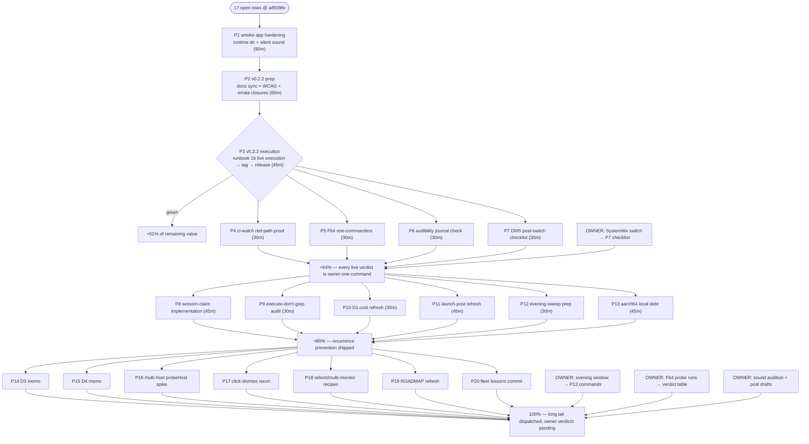

# Pareto Plan — v0.2.2, the owner-window one-commanders, and the long tail

**Written:** 2026-11-18 14:11 CET · **Input:** TODO_LIST @ `a8939fe` (17 open rows + D4 + ROADMAP themes) · **Method:** pareto-planning skill (step 0 errata → 1%/4%/20% → 30–100 min plan → ≤12 min breakdown → execution graph) · **Horizon:** everything executable by an agent on this host, plus clearly-marked owner-window items.

**Errata from step 0 (stale-item corrections — the prior 22-00 plan and the TODO sweep missed these):**

1. **Row 25 (tag-triggered CI) is DECIDED but still open** — the closure edit (`DECLINED, recorded in AGENTS CI notes, 373690e`) was lost to a daemon race when TODO_LIST was swept mid-batch. Re-close in the docs sweep (P2).
2. **Row 34 (live-verification debts) is half-stale** — the real-monitor render leg closed 2026-11-18 (demo transient grim capture, recorded in AGENTS + the 13-26 report); the row's "rides the SystemNix switch" tail is dead text. Re-sweep in P2.
3. **Row 88 (ci-watch) shrank**: the GREEN path is already self-verified — the scheduled run fired on `2690cf7` and passed at 12:37 UTC. Only the RED path (sentinel fails on a red master) remains unproven. Task P4 scoped to that.
4. **Row 87 (release runbook execute-app) is half-done**: AGENTS step 1b is written; the row's remaining value is the first real exercise, which rides the v0.2.2 cut (P3). Fold on execution, don't re-plan.
5. **Launch posts (T19 of the 22-00 plan) are lighter than planned**: the drafts were already refreshed for v0.2 (sounds/ledger/incident-honesty, version-agnostic titles) — the v0.2.1 refresh is a link + one story paragraph, not a rewrite.

## The Pareto

### The 1% that delivers 51% — "one correct release"

**P2 + P3 (cut v0.2.2 properly) + P1 (make the release's own run-tool safe).** Every user-facing value still on the table ships through one release: the **dns block-page/split-horizon validation** (47176c3 — today a host behind a DNS blocker cannot see its own real outage; that is the single biggest correctness gap left in the product), the smoke-transient crash fixes (`41b3f49` — v0.2.1 shipped a `nix run` that dies), dependency currency (hyperframes 0.9.52 + re-rendered demo.mp4, starlight 0.43.1), and the runbook's new execute-before-tag discipline. P1 first, because the release's own checklist executes the app — and the app currently shares the live unit's runtime dir (the 2026-11-18 live-desktop regression class).

### The 4% that delivers 64% — 1% + "the owner-window one-commanders"

Add **P4–P7, P12** (≈2.5 h): every remaining "live verdict" becomes a one-command item the owner can run in a single sitting — F64 sandbox probes (ready-to-run transient recipes with expected failure signatures), the ci-watch red-path proof, the demo-cue audibility journal check, and the DMS plugin post-switch checklist. After this tier, nothing open requires an agent at a live session — the owner closes rows in one window.

### The 20% that delivers 80% — 4% + "recurrence prevention & knowledge"

Add **P8–P11, P17–P20** (≈4 h): the session-claim protocol implementation (stops the daemon/parallel-session sweep class), the execute-don't-grep gate audit (the smoke trio's lesson, generalized), the fleet lessons commit (busctl substitute, the shell cd/relative-path quirk, heredoc quoting in Nix — three lessons that already burned real time twice), the D1 cost-refresh memo, the aarch64 local verification debt, the launch-post v0.2.1 refresh, and the evening-sweep prep.

### The other 80% (to 100%) — the long tail, kept visible

**P13–P16** plus the owner-only items (sound audition, SystemNix switch, posting, evening windows) and the watch rows (TS7, picomatch, D3/D4 memos). None blocks the 80%; all stay dispatched below.

## Comprehensive plan (30–100 min tasks, ALL TODOs, sorted by tier → impact/effort/value)

| #   | Tier | Task (30–100 min)                                                                                                                                                                                                                                                                          | TODO rows      | Min | Impact | Effort | Value |
| --- | ---- | ------------------------------------------------------------------------------------------------------------------------------------------------------------------------------------------------------------------------------------------------------------------------------------------ | -------------- | --- | ------ | ------ | ----- |
| P1  | 1%   | **Smoke app hardening**: distinct `*-smoke` RuntimeDirectory + matching ReadWritePaths shapes; sound inert unless `OFFLINE_BANNER_SMOKE_SOUND=1`; update smoke-script shim asserts; verify x86_64 + binfmt aarch64; AGENTS runbook hazard note rewritten to "fixed"                        | 86             | 90  | 4      | M      | 4     |
| P2  | 1%   | **v0.2.2 prep**: CHANGELOG fold prep, website changelog page + configuration page dns-behavior callout, WCAG table re-audit under 0.9.52, stale-version prose sweep (`0.8.163/0.8.214/320be2a/93fc621`), dropped-edit doc sweep (re-close rows 25/34 with their already-recorded verdicts) | 90, 87, 25, 34 | 60  | 5      | M      | 5     |
| P3  | 1%   | **v0.2.2 execution**: quiet-tree gate → runbook step 1b (execute the app live: demo + stop + live-unit heartbeat check) → tag → curated release (dns behavior-change callout up top) → tag-source verify → website deploy confirm → close rows 87/90                                       | 90, 87         | 45  | 5      | M      | 5     |
| P4  | 4%   | **ci-watch red-path proof**: dispatch the sentinel while a deliberately-failed run is latest (scratch branch drill or a temporary `workflow_dispatch` failure injection), confirm non-zero exit + notification, restore green                                                              | 88             | 30  | 3      | S      | 3     |
| P5  | 4%   | **F64 one-commanders**: `PrivateDevices` + `MemoryDenyWriteExecute` transient recipes (demo env, expected signatures, verdict table) written into the sandbox runbook block — owner runs each in one command                                                                               | 54             | 30  | 3      | S      | 4     |
| P6  | 4%   | **Audibility check**: journal the 12:46 window for the pw-play line; if retained, record the cue-firing evidence; sharpen the owner question to yes/no                                                                                                                                     | 89             | 30  | 2      | S      | 3     |
| P7  | 4%   | **DMS post-switch checklist**: enable steps, expected widget states (online-silent / degraded / offline / stale), stale-tell test recipe, `systemnix-banner` parity note — one page the owner follows after the switch                                                                     | 16, 80         | 30  | 3      | S      | 4     |
| P8  | 20%  | **Session-claim protocol, agent side**: claim-file writer/reader snippet (`.session-claim`, heartbeat, refuse-if-fresh), rc-guard hook, gitignore entry; daemon-skip documented as owner-side                                                                                              | 85             | 45  | 3      | M      | 3     |
| P9  | 20%  | **Execute-don't-grep audit**: classify every flake check's proof class (executes vs greps); fix any grep-only gate that guards executable behavior; record the verdict table in AGENTS Checks                                                                                              | —              | 30  | 3      | S      | 3     |
| P10 | 20%  | **D1 cost refresh**: time `nix build .#checks.x86_64-linux.vm-smoke` + the aarch64 equivalent locally; rewrite row 78's decision memo with fresh numbers                                                                                                                                   | 78             | 30  | 2      | S      | 2     |
| P11 | 20%  | **Launch-post v0.2.1 refresh**: drafts gain the legs/ladder story + the three incident fixes + release link; owner-ready                                                                                                                                                                   | T19            | 45  | 3      | S      | 3     |
| P12 | 4%   | **Evening-sweep prep**: exact journal command set + the verdict criteria that close rows 15/77 in one sitting                                                                                                                                                                              | 15, 77         | 30  | 2      | S      | 2     |
| P13 | 20%  | **aarch64 local debt**: full `nix flake check --all-systems` on binfmt locally for the smoke/leg changes; record timings                                                                                                                                                                   | —              | 45  | 2      | M      | 2     |
| P14 | tail | **D3 backfill memo**: what the journal sweep can and cannot reconstruct; decision text drafted for row 79                                                                                                                                                                                  | 79             | 30  | 2      | S      | 2     |
| P15 | tail | **D4 BuildFlow memo**: real `.buildflow.yml` vs skip-non-managed; kills the global.out.css/dprint resurrection class at the source                                                                                                                                                         | D4             | 30  | 2      | S      | 2     |
| P16 | tail | **Multi-host probeHost decision spike** (ROADMAP theme 1): read the ladder paths, draft the any-success/all-fail semantics memo; implementation gated on owner                                                                                                                             | theme 1        | 60  | 3      | M      | 2     |
| P17 | tail | **Click-dismiss harness recon**: wlrctl/virtual-pointer feasibility on niri; verdict into row 34                                                                                                                                                                                           | 34             | 30  | 2      | S      | 2     |
| P18 | tail | **Reboot/re-login + multi-monitor ready-recipes**: exact post-reboot checklist and second-output test for row 34                                                                                                                                                                           | 34             | 30  | 2      | S      | 2     |
| P19 | tail | **ROADMAP themes 2–5 refresh**: prune realized ideas (sounds/ledger, shell-compat), keep demand-gated ones honest                                                                                                                                                                          | ROADMAP        | 30  | 2      | S      | 1     |
| P20 | tail | **Fleet lessons commit** (crush-config repo): busctl substitute, shell cd/relative-path quirk, heredoc quoting inside Nix strings — committed there, referenced here                                                                                                                       | —              | 30  | 2      | S      | 2     |

**Owner-only (never agent-scheduled):** sound audition (row 22), posting the drafts (after P11), the SystemNix switch (row 76 → then P7), running P5's probes + the evening windows (rows 15/54/77), D1/D3/D4 verdicts (after P10/P14/P15).

## Fine breakdown (≤12 min micro-tasks, ALL TODOs, same sort)

| #  | Task                                                                                                                             | Min     | From    |
| -- | -------------------------------------------------------------------------------------------------------------------------------- | ------- | ------- |
| 1  | P1: rename smoke `RuntimeDirectory`/`ReadWritePaths` shapes to `offline-banner-smoke`-suffixed in `smokeRunner` props derivation | 12      | 86      |
| 2  | P1: add `OFFLINE_BANNER_SMOKE_SOUND` seam (sound env only when set; silent default)                                              | 10      | 86      |
| 3  | P1: update smoke-script shim asserts for the new dir shapes + keep-list coverage keys                                            | 12      | 86      |
| 4  | P1: `nix build .#checks.x86_64-linux.smoke-script -L` green                                                                      | 8       | 86      |
| 5  | P1: binfmt aarch64 smoke-script green                                                                                            | 10      | 86      |
| 6  | P1: rewrite AGENTS runbook hazard note to "fixed; transient uses its own dirs"                                                   | 8       | 86      |
| 7  | P1: commit (detailed message, pathspec-bounded) + daemon precheck                                                                | 5       | 86      |
| 8  | P2: grep living docs for stale `0.8.163                                                                                          | 0.8.214 | 320be2a |
| 9  | P2: CHANGELOG `[Unreleased]` → `[0.2.2]` fold + compare footer                                                                   | 10      | 90      |
| 10 | P2: website changelog page `## 0.2.2` section                                                                                    | 10      | 90      |
| 11 | P2: configuration.mdx dns-behavior callout (blocked probe name → real outage now)                                                | 8       | 90      |
| 12 | P2: WCAG re-audit — `hyperframes check` output table under 0.9.52, record in AGENTS video line                                   | 12      | 90      |
| 13 | P2: re-close row 25 with the declined verdict (restores the dropped edit)                                                        | 5       | 25      |
| 14 | P2: re-sweep row 34 (real-monitor leg closed 2026-11-18; tails updated)                                                          | 8       | 34      |
| 15 | P2: `astro check` + build + html-validate green                                                                                  | 12      | 90      |
| 16 | P2: commit + push, wait both workflows green                                                                                     | 12      | 90      |
| 17 | P3: quiet-tree gate (`git status`, `git log -5`, no in-flight session commits)                                                   | 5       | 90      |
| 18 | P3: runbook 1b — `OFFLINE_BANNER_SMOKE_DEMO=1 nix run .#smoke`, journal `state=shown` confirmed                                  | 12      | 87      |
| 19 | P3: stop transient, busctl-restart live unit if runtime dir cleaned, heartbeat verified                                          | 10      | 87      |
| 20 | P3: `git tag -a v0.2.2` + push                                                                                                   | 5       | 90      |
| 21 | P3: curated release (dns behavior change first), `--verify-tag`                                                                  | 12      | 90      |
| 22 | P3: tag-source verify (`flake metadata` + `flake check …/v0.2.2 --all-systems`)                                                  | 12      | 90      |
| 23 | P3: website deploy confirm on the release commit                                                                                 | 8       | 90      |
| 24 | P3: close rows 87 + 90 with run evidence                                                                                         | 8       | 90      |
| 25 | P4: design the red-path drill (scratch branch with a failing step, or dispatch-on-red simulation)                                | 12      | 88      |
| 26 | P4: run the drill, capture the sentinel's failure exit + notification                                                            | 12      | 88      |
| 27 | P4: restore green, record the proof in row 88, close it                                                                          | 6       | 88      |
| 28 | P5: write the `PrivateDevices` transient recipe (command + expected seccomp/mount signature)                                     | 12      | 54      |
| 29 | P5: write the `MemoryDenyWriteExecute` recipe + verdict table into AGENTS sandbox block                                          | 12      | 54      |
| 30 | P5: smoke-test both recipes' command syntax locally (no live execution — owner window)                                           | 6       | 54      |
| 31 | P6: `journalctl --user -u offline-banner-smoke.service --since "2026-11-18 12:40"` for pw-play                                   | 8       | 89      |
| 32 | P6: record cue-firing evidence + the precise owner question in row 89                                                            | 8       | 89      |
| 33 | P7: draft the DMS enable steps (where the plugin list lives, what toggles)                                                       | 12      | 16      |
| 34 | P7: widget-state expectations table (online/degraded/offline/stale/demo)                                                         | 10      | 80      |
| 35 | P7: stale-tell test recipe (kill-unit → `stale` marker → restart recovery)                                                       | 8       | 80      |
| 36 | P7: parity check `systemnix-banner` runs the contrib script single-sourced                                                       | 8       | 16      |
| 37 | P8: write `.session-claim` writer/reader snippet (shell, heartbeat check)                                                        | 12      | 85      |
| 38 | P8: rc-guard hook wiring + gitignore entry                                                                                       | 10      | 85      |
| 39 | P8: document the daemon-skip owner step; mark row 85 agent-side done                                                             | 8       | 85      |
| 40 | P9: inventory every flake check into a proof-class table (executes/greps/mixed)                                                  | 12      | —       |
| 41 | P9: fix any grep-only gate guarding executable behavior (expected: none or one)                                                  | 12      | —       |
| 42 | P9: record the verdict table in AGENTS Checks                                                                                    | 6       | —       |
| 43 | P10: time `nix build .#checks.x86_64-linux.vm-smoke -L`                                                                          | 12      | 78      |
| 44 | P10: time the aarch64 vm-smoke build (binfmt)                                                                                    | 12      | 78      |
| 45 | P10: rewrite row 78's memo with fresh numbers                                                                                    | 6       | 78      |
| 46 | P11: refresh Discourse draft (v0.2.1 legs/ladder + incident fixes + link)                                                        | 12      | T19     |
| 47 | P11: refresh r/NixOS draft (same story, version-agnostic title)                                                                  | 10      | T19     |
| 48 | P11: final read-through against github-voice; mark owner-ready                                                                   | 10      | T19     |
| 49 | P12: write the evening journal command set (flap counts, degraded-vs-offline ratios)                                             | 10      | 15      |
| 50 | P12: write the row-15/77 verdict criteria into the rows themselves                                                               | 10      | 77      |
| 51 | P13: `nix flake check --all-systems -L` locally on binfmt aarch64, timed                                                         | 12      | —       |
| 52 | P13: record timings + any aarch64-only findings                                                                                  | 10      | —       |
| 53 | P14: D3 memo — journal-reconstructable window vs unrecoverable; draft decision text                                              | 12      | 79      |
| 54 | P14: paste draft into row 79; mark owner-ready                                                                                   | 8       | 79      |
| 55 | P15: D4 memo — `.buildflow.yml` adoption cost vs BuildFlow skip; draft decision text                                             | 12      | D4      |
| 56 | P15: paste draft into AGENTS dprint/BuildFlow note; mark owner-ready                                                             | 8       | D4      |
| 57 | P16: read the ladder/probe paths for multi-host semantics (any-success vs all-fail)                                              | 12      | theme 1 |
| 58 | P16: draft the semantics decision memo into ROADMAP theme 1                                                                      | 12      | theme 1 |
| 59 | P16: tag the memo "implementation gated on owner"                                                                                | 6       | theme 1 |
| 60 | P17: wlrctl/virtual-pointer feasibility recon on niri (docs + a dry command)                                                     | 12      | 34      |
| 61 | P17: verdict into row 34 (harness viable / not viable + why)                                                                     | 8       | 34      |
| 62 | P18: post-reboot auto-start checklist (unit state, journal, first-start behavior)                                                | 10      | 34      |
| 63 | P18: second-output test recipe (attach monitor → surfaces per output → grim both)                                                | 10      | 34      |
| 64 | P19: ROADMAP themes 2–5 prune (realized ideas struck, demand-gated kept)                                                         | 12      | ROADMAP |
| 65 | P19: theme 5 ecosystem items re-verified against current state                                                                   | 8       | ROADMAP |
| 66 | P20: crush-config lessons — busctl substitute + cd/relative-path quirk + Nix heredoc quoting, committed there                    | 12      | —       |
| 67 | P20: reference the lessons file from this repo's AGENTS gotchas                                                                  | 6       | —       |
| 68 | Battery: docs-gates `run .` after the last docs write                                                                            | 8       | —       |
| 69 | `nix fmt` + `nix flake check --all-systems` before each push                                                                     | 10      | —       |
| 70 | Push policy: only on green local gates; watch CI; `gh run watch` on the tip                                                      | 10      | —       |

**Owner-only micro-list:** audition 12 cues (`nix build .#sounds && scripts/play-sounds.sh`) · run P5's two probe commands in a window · post the drafts · the SystemNix switch (then follow P7's checklist) · D1/D3/D4 verdicts · the evening window itself.

## Execution graph

## Verschlimmbesser guards

- The smoke app changes MUST keep the execution gate's assertions true (shim asserts updated in the same commit as the shape change — never green-by-weakening).
- Row 25/34 re-closures restore verdicts that ALREADY exist in AGENTS/the report — text-only sweeps, no new claims.
- No ROADMAP deletions: realized ideas get struck-with-verdict, demand-gated ideas stay.
- The claim-file protocol never blocks the daemon unilaterally — the daemon-skip is owner-side config.
- Every push behind green local gates (`nix fmt`, `nix flake check --all-systems`, docs battery); never push red (runbook rule 1).
